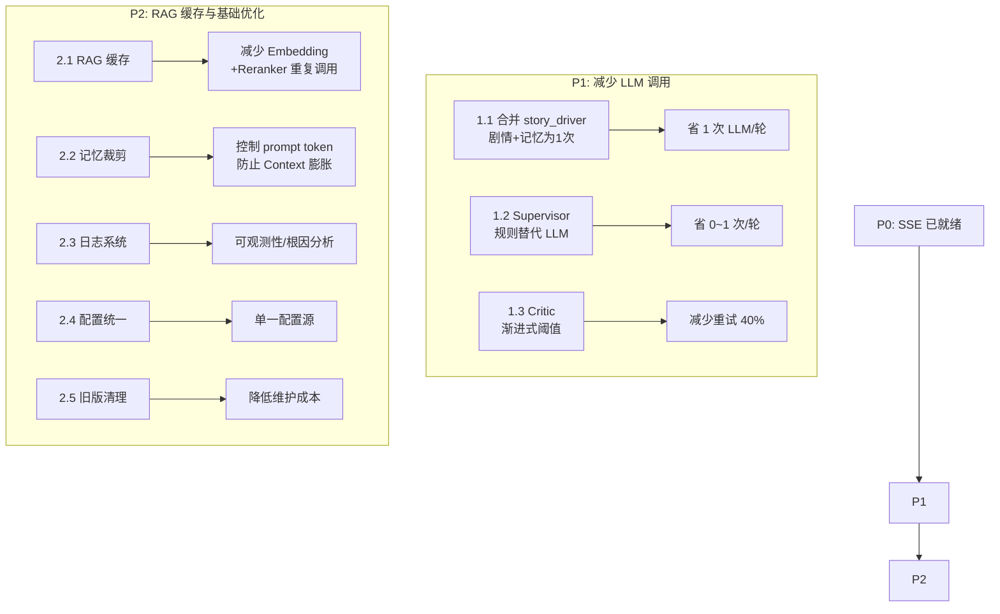

## P1：减少 LLM 调用次数

### 核心目标
将每轮正常的 5 次 LLM 调用降至 2-3 次，消除不必要的冗余调用，缩短端到端响应时间。

### 优化方向

**1. 合并 story_driver 的剧情生成 + 记忆提取为 1 次 LLM 调用（省 1 次/轮）**
当前 story_driver 先调 LLM 生成 segment+options（JSON），随后调 extract_memory_updates 再调一次 LLM 提取记忆更新。将 memory updates 合并到 story_driver 输出的 JSON 中，一次 LLM 调用同时产出剧情片段、选项和记忆更新。这是收益最高的优化项（省 1 次 LLM/每轮）。

**2. Supervisor 规则匹配替代 LLM 解析（省 0~1 次/轮）**
当前 parse_user_input 对特殊指令（A/B/C/D、生成全文、回溯）用规则匹配，但兜底总是调 LLM。增加关键词匹配层：将常见自由输入（"继续"、"然后呢"、"下一步"→ select_option A；"不行"、"重来"→ backtrack；角色扮演语句→ free_input）先用规则处理，仅当规则无法判断时再用 LLM。LLM 调用率预计降到 20% 以下。

**3. Critic 渐进式阈值（减少重试轮次，省 0~3 次/轮）**
当前 PASS_THRESHOLD=6 固定不变，第 1 次和第 3 次重试门槛相同。改为渐进式：第 1 次 6 分、第 2 次 5 分、第 3 次 4 分（最大迭代次数时直接放行不变）。减少不必要的人工审核中断和重写循环。

### 预期效果
- 正常流程：5 次 LLM 调用 -> 2-3 次（story_driver 1 次 + critic 1 次 + integrator 0~1 次）
- 有 LLM 解析场景：6 次 -> 3~4 次
- Critic 重试概率降低约 40%

---

## P2：RAG 缓存与基础优化

### 核心目标
减少外部 API 重复调用、控制 prompt token 成本、提升系统可观测性和可维护性。

### 优化方向

**1. RAG 检索结果缓存（减少 Embedding + Reranker API 重复调用）**
当前 story_driver 每轮都调 retrieve_for_writing（ChromaDB 向量检索 + Reranker API），即使查询高度相似。增加进程内 LRU 缓存，key 为查询内容的 MD5 哈希，TTL 300 秒。同一轮内相似查询命中缓存，避免重复 API 调用。RAG 重复调用预计减少 60% 以上。

**2. 记忆上下文滑动窗口裁剪（控制 prompt token 成本）**
当前 build_memory_context 包含所有角色、线索、伏笔、时间线，随轮次线性增长。增加裁剪策略：
- 角色：仅包含 last_appearance >= current_turn-5 的角色
- 剧情线索：仅包含活跃线索，已解决/废弃的排除
- 伏笔：仅包含最近 10 条待回收伏笔
- 时间线：仅保留最近 5 条（已有，不变）
- World notes：仅保留最近 10 条
预计记忆上下文 token 量从 O(N) 降为 O(1)

**3. 日志系统实现**
当前 src/utils/logger.py 为空 TODO。实现结构化日志：
- 按天轮转的文件日志 + 控制台输出
- INFO 级别：LLM 调用次数、耗时、token 消耗；节点执行时间
- WARNING 级别：重试、API 错误、缓存失效
- ERROR 级别：异常与关键故障
- 日志格式：[时间] [级别] [模块] 消息

**4. 配置统一管理**
当前根目录 config.py（旧版重复）、configs/settings.yaml（空模板）、.env（实际使用）三者分散。将 configs/settings.yaml 作为单一配置源，src/utils/config.py 优先读 YAML，.env 仅作敏感信息覆盖。

**5. 清理旧版代码残留**
- tools/ 与 utils/ 根目录下的 .py 文件是 src/ 对应文件的旧副本
- exchange_rag_agent/ 是独立 RAG 代理，功能与 src/tools/rag_tool.py 重叠
- 清理后降低维护负担 30%


## 技术方案

### 项目架构
```
Project: 交互式多 Agent 协作小说创作系统
Language: Python 3.11+
Framework: LangGraph + FastAPI
Vector DB: ChromaDB
Reranker: SiliconFlow Reranker API
State Management: SQLite/Postgres Checkpointer
```

### P1 实施详情

#### 1.1 合并 story_driver + 记忆提取

**方案**: 修改 `src/prompts/writer_prompt.py` 的 `STORY_DRIVER_PROMPT`，在 JSON 输出中增加 memory_updates 字段。修改 `src/agents/writer.py` 的 `story_driver_node`，从同一 JSON 中解析记忆更新，移除对 `extract_memory_updates` 的调用。

```python
# writer_prompt.py 新增字段
# 输出 JSON 格式：
# {
#   "segment": "...",
#   "options": [...],
#   "memory_updates": {
#     "character_updates": [...],
#     "new_plot_threads": [...],
#     "resolved_threads": [...],
#     "new_foreshadowing": [...],
#     "fulfilled_foreshadowing": [...],
#     "timeline_events": [...],
#     "world_notes": [...]
#   }
# }
```

**改动范围**:
- `src/prompts/writer_prompt.py` [MODIFY]: STORY_DRIVER_PROMPT 增加 memory_updates 输出指示
- `src/agents/writer.py` [MODIFY]: story_driver_node 解析 memory_updates 并合并状态，移除 `extract_memory_updates` 调用
- `src/tools/memory.py` [MODIFY]: 导出 `_apply_updates` 供 writer 直接使用（writer 不再调用 `extract_memory_updates`，但 `_apply_updates` 仍需要）

#### 1.2 Supervisor 规则匹配替代 LLM 解析

**方案**: 在 `parse_user_input` 中增加关键词匹配层，仅当规则无法判定时回退到 LLM。

```python
# 新增规则：
RULES = [
    (r"继续|然后呢|下一步|接着说", {"action": "select_option", "selected_option": "A"}),
    (r"不行|换一个|重来|不好", {"action": "backtrack"}),
    (r"生成全文|写完整|全部", {"action": "generate_full"}),
    (r"确认|可以|好的|就这样", {"action": "select_option", "selected_option": "A"}),
    (r"修改|改一下|换个|不同", {"action": "free_input"}),
]
```

**改动范围**: `src/agents/supervisor.py` [MODIFY]: parse_user_input 增加规则匹配层

#### 1.3 Critic 渐进式阈值

**方案**: 根据 `iteration_count` 计算有效阈值：`effective_threshold = max(PASS_THRESHOLD - iteration_count, 4)`

**改动范围**: `src/agents/reviewer.py` [MODIFY]: _review_segment 和 _review_setting 使用动态阈值

---

### P2 实施详情

#### 2.1 RAG 缓存

**方案**: 在 `src/tools/rag_tool.py` 中增加 LRU 缓存，keyed by query hash。

```python
import hashlib, time, functools

class TTLCache:
    def __init__(self, maxsize=128, ttl=300):
        self.cache = {}
        self.maxsize = maxsize
        self.ttl = ttl
    
    def get(self, key):
        if key in self.cache:
            value, ts = self.cache[key]
            if time.time() - ts < self.ttl:
                return value
            del self.cache[key]
        return None
    
    def set(self, key, value):
        if len(self.cache) >= self.maxsize:
            # LRU evict
            oldest = min(self.cache, key=lambda k: self.cache[k][1])
            del self.cache[oldest]
        self.cache[key] = (value, time.time())

_cache = TTLCache()

def retrieve(query: str, ...) -> str:
    key = hashlib.md5(query.encode()).hexdigest()
    cached = _cache.get(key)
    if cached is not None:
        return cached
    result = _do_retrieve(query, ...)
    _cache.set(key, result)
    return result
```

**改动范围**: `src/tools/rag_tool.py` [MODIFY]: 增加 TTL 缓存装饰器

#### 2.2 记忆上下文滑动窗口裁剪

**方案**: 修改 `build_memory_context`，按 last_appearance / time 过滤旧条目。

**改动范围**: `src/tools/memory.py` [MODIFY]: build_memory_context 增加裁剪逻辑

#### 2.3 日志系统

**方案**: 实现标准 logging 配置，在关键路径增加日志埋点。

**改动范围**:
- `src/utils/logger.py` [NEW]: 实现 get_logger 工厂函数
- `src/utils/llm.py` [MODIFY]: LLM 调用前后加计时日志
- `src/tools/rag_tool.py` [MODIFY]: 检索耗时日志
- `src/agents/writer.py` [MODIFY]: 节点执行日志
- `src/agents/reviewer.py` [MODIFY]: 节点执行日志
- `src/graph/workflow.py` [MODIFY]: 图执行日志（可选）

#### 2.4 配置统一管理

**方案**: 填充 `configs/settings.yaml`，配置读取优先 YAML、.env 覆盖。

**改动范围**:
- `configs/settings.yaml` [MODIFY]: 填充完整配置项
- `src/utils/config.py` [MODIFY]: 增加 YAML 读取，.env 覆盖

#### 2.5 清理旧版代码

**方案**: 确认旧版文件无引用后删除。

**改动范围**:
- `tools/` [DELETE]: 整个目录（确认 tests 无引用）
- `utils/` [DELETE]: 整个目录（确认 tests 无引用）
- `exchange_rag_agent/` [DELETE]: 整个目录
- `config.py` [DELETE]: 根目录旧版

---

### 实施路线图



### 性能预期

| 指标 | 优化前 | P1 优化后 | P1+P2 优化后 |
|------|--------|-----------|-------------|
| 每轮 LLM 调用（正常） | 5 次 | 2~3 次 | 2~3 次 |
| 每轮 LLM 调用（最坏） | 11+ 次 | 5~7 次 | 5~7 次 |
| RAG API 调用/轮 | 1 次 | 1 次 | 0.4 次（缓存命中） |
| 记忆 token 增长 | O(N) | O(N) | O(1) |
| 端到端响应时间 | 基准 | 缩短 40%~50% | 缩短 50%~60% |

### 实施约束
- P1 和 P2 独立可交付，不互相依赖
- 所有修改需兼容现有测试（mock 模式下 llm_call 返回值不变）
- 不引入新外部依赖（标准库已有 hashlib、time、logging、functools 等）
- 旧版清理需在最后执行，先确认无引用


## Agent Extensions

### SubAgent
- **code-explorer**: 在旧版代码清理步骤中协助搜索所有文件间引用关系，确认 `tools/`、`utils/`、`exchange_rag_agent/` 不再被 `src/`、`tests/` 或 `server.py` 引用。也用于在合并 story_driver 时确认 `extract_memory_updates` 是否被其他模块引用。
