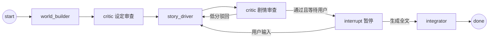

## 用户需求
对「交互式多 Agent 小说创作系统」进行全面瘦身（simplify），保留核心功能，移除非必要外围模块与复杂度。

## 产品概述
保留一个最小可用的交互式小说创作闭环：用户提交创作需求 → 系统构建世界观 → 逐段推进剧情并提供选项 → Critic 内部质控（低分触发人工审核中断）→ 用户请求时整合输出完整小说。保留多会话管理能力（创建/切换/重命名/删除）。前端与后端 REST/SSE 接口保持不变。

## 核心功能（保留）
- **交互式剧情推进**：每轮生成剧情片段 + 2-3 个分支选项，用户选择或自由输入，SSE 打字机流式渲染
- **Critic 人工审核**：Critic 低分中断，前端弹出「通过/驳回」面板，用户决策放行或重写
- **多会话管理**：创建/切换/重命名/删除会话，独立进度与元数据
- **生成全文**：用户请求「生成全文/结束」时由 Integrator 整合为完整小说
- **世界观构建**：基于用户需求生成世界观设定、角色、规则（去掉外部联网搜索）

## 明确移除（简化范围）
- RAG 检索（rag_tool.py）、Bing 联网搜索（search_tool.py）、文档入库（document_util.py）及其全部依赖
- 长期记忆续写（long_term_memory.py）与续写 API（/resume、/memories）
- 回溯能力（segment_history、backtrack 逻辑、前端回退按钮）
- 顶层历史遗留冗余目录（tools/、utils/）
- supervisor 独立路由模块（其路由逻辑固化进 workflow）
- configs 中 RAG/搜索/长期记忆/回溯相关配置项

## 视觉/交互效果
前端保持现有深色玻璃拟态风格不变，仅移除「回退」按钮、续写入口、记忆列表相关 UI；世界观面板、聊天日志、选项栏、人工审核面板、完整小说面板、会话侧边栏均保留。


## 技术栈
- 后端：FastAPI + Uvicorn + LangGraph（StateGraph + interrupt + SQLite Checkpointer）
- LLM：OpenAI 兼容接口（ChatOpenAI，流式）
- 前端：Vue 3 + Element Plus + Vite（SSE 流式渲染）
- 持久化：SQLite（checkpointer + 会话元数据）
- 语言：Python 3.11+ / JavaScript

## 实现方案
### 总体策略
采用「精简而非重写」策略：保留已验证可运行的 LangGraph 图结构与 SSE 流式管线，移除外围模块，将 supervisor 的复杂条件路由固化为更简单的显式边，删除 RAG/搜索/文档/长期记忆/回溯/续写的全部代码与调用。核心 Agent 保留 writer（剧情推进）、reviewer（Critic）、integrator（整合）与内联的 world_builder（取代 researcher.py + Bing）。

### 关键技术决策
1. **删除 supervisor.py，路由固化进 workflow.py**：原 supervisor 承担「解析输入 + 状态路由 + interrupt 暂停」三重职责。简化后：在 story_progressing 阶段用 `interrupt()` 直接暂停等待用户输入；world_builder→critic→story_driver→critic 的环形路由用固定的条件边表达，不再依赖动态 phase 字符串机器。显著降低节点数与分支复杂度，减少出错面。
2. **world_builder 内联化**：researcher.py 仅依赖 LLM + 可选 Bing。简化后删除 Bing，将 world_builder_node 逻辑移入新文件 `src/agents/world_builder.py`（纯 LLM 生成 JSON），复用现有 `researcher_prompt.py` 提示词（保留原名供导入）。
3. **移除 RAG/搜索/文档/长期记忆**：writer.py 删除 `retrieve_for_writing` 调用与 `rag_context` 注入；server.py 删除 `resume_session`、`list_memories`、`get_memory` 路由与 `long_term_memory` 导入；config.py 删除 RAG/搜索/回溯配置；pyproject.toml 删除 mcp/langchain-chroma/langchain-community/pymupdf/docx2txt/langgraph-checkpoint-postgres/asyncpg 依赖。
4. **移除回溯**：state.py 删除 `segment_history`/`plot_version` 及 backtrack 相关字段（保留 memory 以支持一致性）；前端删除回退按钮与「回到上一步」调用。
5. **Postgres 支持移除**：database.py 仅保留 SQLite 分支，workflow 简化 checkpointer 构建。

### 性能与可靠性
- 删除 RAG 后每轮减少 1 次 Embedding + Rerank 网络调用，延迟与成本显著下降。
- 移除 Bing 搜索后 world_builder 仅 1 次 LLM 调用。
- 保留 SQLite checkpointer 断点续跑能力，会话中途关闭可恢复。
- SSE 事件转换（streaming.py）保持不变，打字机效果无回归。

## 实现注意事项
- 所有对 `src.tools.rag_tool`、`search_tool`、`long_term_memory`、`document_util` 的 import 必须彻底清除，避免 ImportError。
- `NovelState` 移除字段后，`server._build_initial_state`、`_state_to_response`、`_save_meta` 需同步删减，避免 KeyError。
- 测试文件依赖被删模块（test_long_term_memory.py、test_graph.py 中 integrator/supervisor 断言、test_tools.py 中 search/rag/document 用例、test_api.py 中 resume/memories 用例）需同步删除或精简，保证 `pytest` 通过。
- server.py 静态挂载 frontend/dist 逻辑保持不变。
- 前端 client.js 删除 resumeSession/listMemories/getMemory 导出；App.vue 删除 onResume/backtrack 及对应事件绑定；SessionSidebar.vue 删除续写按钮与 resume emit。

## 架构设计
简化后图结构（固化路由，无 supervisor 节点）：

人工审核（Critic 低分）在 critic 节点内通过 `interrupt()` 实现，用户批准放行/驳回重写，不新增路由节点。world_builder 完成后直接置 `setting_confirmed=True` 进入剧情，去除原 world_building 二次确认阶段。

## 目录结构与文件改动
```
project-root/
├── server.py                         # [MODIFY] 移除 resume/memories 路由、long_term_memory 导入、backtrack 相关；精简 _save_meta/_state_to_response/_build_initial_state
├── config.py                         # [DELETE] 根目录历史占位空文件
├── pyproject.toml                    # [MODIFY] 移除 mcp/langchain-chroma/langchain-community/pymupdf/docx2txt/langgraph-checkpoint-postgres/asyncpg
├── configs/settings.yaml             # [MODIFY] 删除 rag/misc(mcp_bing/max_backtrack) 段，仅留 llm/story/quality
├── src/agents/
│   ├── supervisor.py                 # [DELETE] 路由与输入解析模块
│   ├── researcher.py                 # [DELETE] Bing 搜索版世界观构建
│   ├── world_builder.py              # [NEW] 纯 LLM 世界观构建（复用 researcher_prompt）
│   ├── writer.py                     # [MODIFY] 删除 rag_context/retrieve_for_writing 与 segment_history 写入
│   ├── reviewer.py                   # [MODIFY] 简化设定确认逻辑（world_builder 已 confirmed）
│   └── integrator.py                 # [KEEP]
├── src/graph/
│   ├── state.py                      # [MODIFY] 删除 segment_history/plot_version
│   ├── workflow.py                   # [MODIFY] 固化路由，移除 supervisor 节点与动态路由函数，用显式条件边
│   ├── edges.py / nodes.py           # [DELETE] 占位文件（若存在）
├── src/prompts/
│   ├── supervisor_prompt.py          # [DELETE]
│   ├── researcher_prompt.py          # [KEEP] 供 world_builder 导入
│   ├── writer_prompt.py              # [MODIFY] 删除 {rag_context} 占位
│   ├── reviewer_prompt.py            # [KEEP]
│   └── integrator_prompt.py         # [KEEP]
├── src/tools/
│   ├── rag_tool.py / search_tool.py / document_util.py / long_term_memory.py  # [DELETE]
│   └── memory.py                     # [KEEP] 保留故事记忆
├── src/utils/
│   ├── config.py                     # [MODIFY] 删除 RAG/搜索/回溯配置常量
│   ├── database.py                   # [MODIFY] 仅保留 SQLite checkpointer
│   ├── llm.py / logger.py / session_store.py / streaming.py  # [KEEP]
├── src/app.py                        # [MODIFY] 同步移除 backtrack/segment_history 字段，world_builder 入口名更新
├── tools/ 与 utils/                  # [DELETE] 顶层历史遗留目录
├── frontend/src/api/client.js         # [MODIFY] 删除 resumeSession/listMemories/getMemory
├── frontend/src/App.vue              # [MODIFY] 删除 onResume/backtrack 及回退按钮、续写事件
├── frontend/src/components/SessionSidebar.vue  # [MODIFY] 删除续写按钮与 resume emit
└── tests/
    ├── test_long_term_memory.py      # [DELETE]
    ├── test_graph.py                 # [MODIFY] 删除 supervisor/integrator 节点断言，改为验证固化图
    ├── test_tools.py                 # [MODIFY] 删除 search/rag/document 用例
    ├── test_api.py                   # [MODIFY] 删除 resume/memories 用例
    └── test_agents.py / test_session_store.py  # [MODIFY] 清理 backtrack/segment_history 相关
```


## Agent Extensions
### SubAgent
- **code-explorer**
  - Purpose: 在删除依赖与改 import 时，跨文件检索所有对已删模块（rag_tool/search_tool/long_term_memory/document_util/supervisor/researcher/segment_history/backtrack）的引用，确保无残留 import 或调用
  - Expected outcome: 产出完整的引用清单，保证删除后项目可导入、pytest 通过、服务可启动
